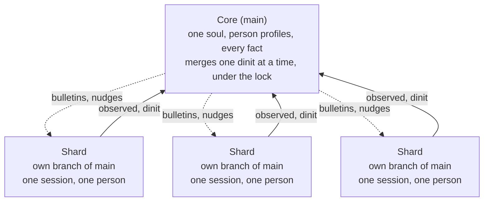
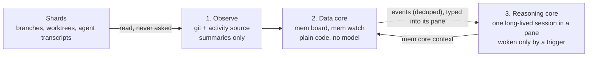

# shards — design

Design of record · November 2026 · Raelyn Rose

## The idea: one soul, many shards

A shards system is one agent with one shared memory, met through many sessions. The core owns **main**, the single true memory. When someone starts working, the core sends them a **shard**: a separate session with the same soul, working on its own branch of main.

- **One shard per session.** A person talks to the same shard for the whole session, so nothing they build together is lost mid-work.
- **One soul, not one per person.** There is never "Alice's agent" or "Bob's agent." Every shard is born from the same soul files in main.
- **Code-switching, not separate selves.** Main keeps one profile per person (tastes, how they like answers, what they're working on). A shard reads the soul, then the profile of whoever it's talking to.
- **Dinit merges back.** When the person is done, the shard dinits: it hands its branch to the core, which merges it into main and checks nothing conflicts.

The core observes shards (it doesn't wait for them to report) and they dinit into main. Later, the core will push bulletins and nudges back down in real time.

## The memory: one home per fact, in git

The memory is a git repository of markdown files. Every fact is one file at one path, and that path is its only home.

| Piece | How it works |
| --- | --- |
| One home | A fact lives at one path, e.g. `facts/devices/ctl/ip.md`. Two homes for one fact can't exist; the drift check flags near-duplicates. |
| Pointers | Notes and chat write `{{fact:devices/ctl/ip}}` instead of the value. Reading it returns the current value and where it lives. |
| Supersede | `mem supersede <path> <value> --why "..."` writes a new version as a commit. Git stamps the time and author; the reason goes in the message. |
| History | `main` is protected: no force-push, no rewritten commits. A bulk find-and-replace can only add a new commit; old values stay readable. |
| Provenance | Every commit names the shard (session) and the human at the keyboard. |

All reads and writes go through one small tool, `mem`, so every agent uses the same door.

## Merging and locks: only the merge into main is locked

Shards never block each other while they work, because each one is on its own branch. The lock guards the one moment that matters: a merge into main. One dinit merges at a time.

**Conflict rules**

- **Different facts changed:** merged automatically. Expected for almost every dinit.
- **The same fact changed by two shards since they branched:** a real conflict. The core keeps both in history and asks the humans (or the latest author) which value is current. It never guesses.
- **A raw value written where a pointer belongs:** flagged at dinit, before the merge.
- **Soul and person profiles:** stricter than facts. Profile updates merge normally; a change to the soul itself is proposed and goes through the core or a human, so one session can't quietly reshape who the agent is.

**Lock settings** (a config file, no code edits)

| Setting | Options |
| --- | --- |
| Scope | the whole store, or per section (top-level folder) |
| When busy | wait in a queue, or fail fast |
| Timeout | how long a waiting merge waits |
| Lease | how long a lock lives without a heartbeat; an expired lock from a crashed writer is recovered |

A blocked writer is told who holds the lock and since when. A shard that crashes leaves an unmerged branch, never a broken main; the core can merge it or discard it.

## Awareness: the core always knows what every shard is doing

The core has to know what every shard is doing, and it must not depend on the shard telling it. A shard can forget, be wrong, or spend effort on status that should go to its person. So awareness is **read, not reported**. Shards just keep working, and a cheap data layer watches them. Reasoning is expensive, so a model is woken only when the data meets a condition the operator configured.

**1. Observe.** For each open shard the core reads two things:

- **What it is changing.** This comes from git: facts, profiles and notes changed on its branch since the merge-base with main, plus uncommitted edits in its worktree (its work *in flight*).
- **What it is doing.** This comes from an activity source. An `ActivitySource` trait keeps this independent of any one agent tool. The first source reads Claude Code session transcripts, which it finds from the shard's worktree path. A `none` source uses git only.

Transcripts are read incrementally. Only the time and a short summary of each tool call are kept: the tool name plus a file basename, or 80 characters of a redacted command. Prompts, answers, file contents and tool results are never stored or shown. If a transcript is missing, the board still works from git. The shard's own one-line gist is still shown when there is one, but nothing depends on it.

**2. Data core.** This is plain code and never calls a model.

- **`mem board`** is one view of every open shard: who it is with, whether it is active, idle or stale, its facts in flight and its last few actions. It also lists **overlaps**:
  - *same fact*: two shards have the same fact in flight, a conflict caught before dinit;
  - *same section*: two shards are working in the same top-level section.

  The board also lists open conflicts and pending soul proposals. Reading it takes no lock and never blocks a writer.
- **`mem watch`** runs the board on a timer and checks configured **triggers**: same fact, same section, a stale shard with work in flight, an open conflict, a soul proposal. Each trigger can be switched on or off in `shards.toml`. A condition fires once while it holds and can fire again after it clears and comes back. Each firing is appended to an event log.

**3. Reasoning core.** This is not a one-shot call. It is one long-lived chat session in a tmux pane, so it remembers what it has reasoned about from one wake to the next.

- **Started once.** `mem core start` runs the core's command in a pane on its own tmux server, with a first message: read the soul, then `mem core context`, which gives it the board and the pending events in one document. The session's id is pinned, so the core is always the same session.
- **Woken by typing.** When events are pending, the watcher types one short line into the pane. The core reads the details itself and acknowledges when it has handled them. Until then the events stay pending, and the same pending set never wakes it twice. Reasoning isn't rate-limited by default; an optional cooldown can cap it.
- **Open to people.** A person can attach to the pane and talk to the core directly.
- **Kept alive.** A watchdog restores a dead pane or command and resumes the pinned session by its id, never "the most recent one". It gives up after three failures and says so. A deliberate stop stays stopped.
- **Handing off.** A long session fills up. Before it does, the core writes a baton, and a handoff starts a fresh session in the same pane with the baton as its first message. If any step fails, the old session stays the core. What the core knows for good belongs in the memory, not in its chat; `soul/core.md` says so in plain words.
- **Measured, not guessed.** Prompt caches expire, so a wake after a long silence may cost more. An optional keep-warm heartbeat (off by default) pings an idle core. Every wake and ping is logged with the token counts of the reply, so the two can be compared before anyone decides whether keep-warm is worth it.

The agent tool sits behind an adapter, so the rest of the system doesn't assume Claude Code. The older mode, an external command run with the events on stdin, is still there for operators who want it.

**Later: nudges and bulletins.** What the reasoning core decides still has to reach the shards. Two channels are planned:

- **Nudges** tell two shards that their people are on the same thing and should talk.
- **Bulletins** tell every live shard about a core decision before its next reply. They ride a Claude Code hook that runs on every turn.

Delivery to shards is not built yet.

## Decisions

- Written in Rust; AGPL-3.0.
- Person profiles live in main.
- The soul changes very rarely: a soul change requires a human admin.
- Timestamps are stored in UTC (RFC 3339); interfaces show local time.
