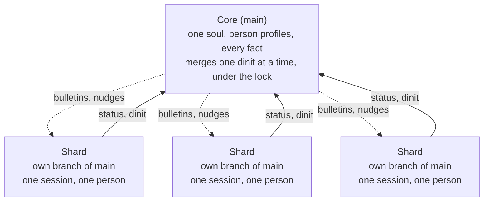

# shards — design

Design of record · November 2026 · Raelyn Rose

## The idea: one soul, many shards

A shards system is one agent with one shared memory, met through many sessions. The core owns **main**, the single true memory. When someone starts working, the core sends them a **shard**: a separate session with the same soul, working on its own branch of main.

- **One shard per session.** A person talks to the same shard for the whole session, so nothing they build together is lost mid-work.
- **One soul, not one per person.** There is never "Alice's agent" or "Bob's agent." Every shard is born from the same soul files in main.
- **Code-switching, not separate selves.** Main keeps one profile per person (tastes, how they like answers, what they're working on). A shard reads the soul, then the profile of whoever it's talking to.
- **Dinit merges back.** When the person is done, the shard dinits: it hands its branch to the core, which merges it into main and checks nothing conflicts.

Shards report up and dinit into main; the core pushes bulletins and nudges back down in real time.

## The memory: one home per fact, in git

The memory is a git repository of markdown files. Every fact is one file at one path, and that path is its only home.

| Piece | How it works |
| --- | --- |
| One home | A fact lives at one path, e.g. `facts/devices/ctl/ip.md`. Two homes for one fact can't exist; the drift check flags near-duplicates. |
| Pointers | Notes and chat write `{{fact:devices/ctl/ip}}` instead of the value. Reading it returns the current value and where it lives. |
| Supersede | `mem supersede <path> <value> --why "..."` writes a new version as a commit. Git stamps the time and author; the reason goes in the message. |
| History | `main` is protected: no force-push, no rewritten commits. A bulk find-and-replace can only add a new commit; old values stay readable. |
| Provenance | Every commit names the shard (session) and the human at the keyboard. |

All reads and writes go through one small tool, `mem`, so every agent uses the same door.

## Merging and locks: only the merge into main is locked

Shards never block each other while they work, because each one is on its own branch. The lock guards the one moment that matters: a merge into main. One dinit merges at a time.

**Conflict rules**

- **Different facts changed:** merged automatically. Expected for almost every dinit.
- **The same fact changed by two shards since they branched:** a real conflict. The core keeps both in history and asks the humans (or the latest author) which value is current. It never guesses.
- **A raw value written where a pointer belongs:** flagged at dinit, before the merge.
- **Soul and person profiles:** stricter than facts. Profile updates merge normally; a change to the soul itself is proposed and goes through the core or a human, so one session can't quietly reshape who the agent is.

**Lock settings** (a config file, no code edits)

| Setting | Options |
| --- | --- |
| Scope | the whole store, or per section (top-level folder) |
| When busy | wait in a queue, or fail fast |
| Timeout | how long a waiting merge waits |
| Lease | how long a lock lives without a heartbeat; an expired lock from a crashed writer is recovered |

A blocked writer is told who holds the lock and since when. A shard that crashes leaves an unmerged branch, never a broken main; the core can merge it or discard it.

## Awareness: the core always knows what every shard is doing

The core decides what spreads between shards. Three channels carry it:

1. **Status (shard to core).** Every shard keeps a one-line gist for its person, "currently working on X," updated as it goes. The core sees a live board of all shards and can open any shard's branch for detail.
2. **Nudges (core to specific shards).** When two gists overlap, the core tells both shards, which tell their people: "your user and another user are on the same thing; you should be talking."
3. **Bulletins (core to every shard, in real time).** When a core decision lands in main, or something very important comes up, the core posts it. Every live shard sees it before its next reply, not at the next dinit.

Bulletins ride a Claude Code hook that runs on every turn, the same way a timestamp can be injected into each turn today. That gives real-time delivery with no extra server.

## Decisions

- Written in Rust; AGPL-3.0.
- Person profiles live in main.
- The soul changes very rarely: a soul change requires a human admin.
- Timestamps are stored in UTC (RFC 3339); interfaces show local time.
