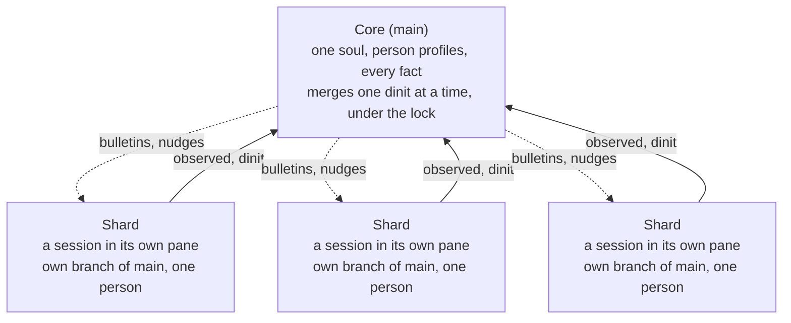
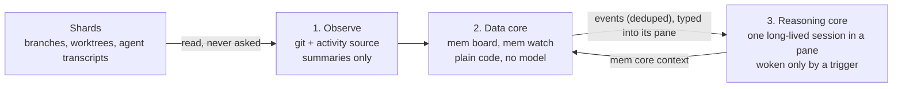

# shards — design

Design of record · November 2026 · Raelyn Rose

## The idea: one soul, many shards

A shards system is one agent with one shared memory, met through many sessions. The core owns **main**, the single true memory. When someone starts working, the core sends them a **shard**: a separate session with the same soul, working on its own branch of main.

- **A shard is a session in a pane.** A shard is a whole agent session in its own tmux pane, the same shape as the core, not a sub-agent. A person talks to the same shard for the whole session, so nothing they build together is lost mid-work. Its pane stays up until the person says they're done; nothing closes it for being idle or stale.
- **One soul, not one per person.** There is never "Alice's agent" or "Bob's agent." Every shard is born from the same soul files in main.
- **Code-switching, not separate selves.** Main keeps one profile per person (tastes, how they like answers, what they're working on). A shard reads the soul, then the profile of whoever it's talking to.
- **Dinit hands back a proposal.** The core decides facts and people. When the person is done, the shard dinits: its notes merge into main, and its fact and people changes become one proposal. The core reviews each change, accepting, fixing, rejecting or holding it for a human, and only accepted changes reach main.

The core observes shards (it doesn't wait for them to report) and they dinit into main. Later, the core will push bulletins and nudges back down in real time.

## The memory: one home per fact, in git

The memory is a git repository of markdown files. Every fact is one file at one path, and that path is its only home.

| Piece | How it works |
| --- | --- |
| One home | A fact lives at one path, e.g. `facts/devices/ctl/ip.md`. Two homes for one fact can't exist; the drift check flags near-duplicates. |
| Pointers | Notes and chat write `{{fact:devices/ctl/ip}}` instead of the value. Reading it returns the current value and where it lives. |
| Index | `mem index [section]` lists every address with a one-line description and no values, so it can never be a second home for a fact. |
| Supersede | `mem supersede <path> <value> --why "..."` writes a new version as a commit. Git stamps the time and author; the reason goes in the message. |
| History | `main` is protected: no force-push, no rewritten commits. A bulk find-and-replace can only add a new commit; old values stay readable. |
| Provenance | Every commit names the shard (session) and the human at the keyboard. |

All reads and writes go through one small tool, `mem`, so every agent uses the same door.

## Shards: a session in its own pane

A shard is one long-lived agent session, run like the core: a pane on a tmux server of the system's own, with the session id pinned so it is always the same session.

- **Started.** `mem shard start` opens the shard (its branch and worktree), then starts the agent in a pane whose shell sits in the worktree. All shards share one shards tmux server. Each is its own tmux session there, so two people can attach to two shards at once.
- **Pinned before it speaks.** The id is chosen up front (`--session-id`) and recorded with the shard, because a blank session writes no transcript until its first message.
- **Started with its init.** A shard's first context is its init, `soul/init-shard.md` from main, followed by `mem shard context`: who it is with, their profile, the open questions they may answer, the open quirks. The person speaks first.
- **Up until done.** Nothing closes a shard's pane for being idle or stale. `mem shard stop` ends the session cleanly and keeps the branch, worktree and pin; `--resume` brings the pinned session back by its id. A clean dinit stops the session before it closes the shard.
- **Unattended.** Claude Code asks whether to trust a new folder, but it keeps that answer per canonical git root. A shard's worktree is a worktree of the memory, so trusting the memory root once covers every shard. `mem` checks this (read only) before it opens anything, and a trust question on screen fails the start at once rather than leaving a pane waiting.
- **Survives its launcher.** The tmux server starts in its own systemd scope, so restarting whatever ran `mem` (a web UI's service) doesn't kill the panes.
- **Talked to through its own transcript.** `mem shard send` types into one shard's pane and confirms the message in that shard's transcript, found by its pinned id. A chat UI reads each shard's transcript by that id, never by looking for the text it sent, so the same words sent to two shards can't cross.

An idle pane costs about 255–275 MiB of RAM (Claude Code 2.1.319).

## Merging and locks: only the merge into main is locked

Shards never block each other while they work, because each one is on its own branch. The lock guards the one moment that matters: a merge into main. One dinit merges at a time.

**Conflict rules**

- **Notes:** merged at dinit with no review. Notes are never facts.
- **Facts and people:** never merged at dinit. Each change goes into one proposal record on main, with its value and the shard's reason, and waits for the core. Every change needs a reason when the shard makes it. Every change is reviewed: there is no auto-accept and no small-change path.
- **Accepting:** the change goes to main under the lock, stamped with the shard, its human, the shard's reason and the core's reason. Every decision is logged with its reason in the record, and nothing is deleted.
- **Main moved before the accept:** if main changed the same fact since the proposal was made, accepting records a conflict, the same as at dinit.
- **The same fact changed by two shards since they branched:** a real conflict. The core keeps both in history and asks the humans (or the latest author) which value is current. It never guesses.
- **A person's pick is final.** Settling a conflict puts the chosen value on main with no proposal review, because a person settling it outranks the core. It needs the settler's name and a reason, and writes an **incident**: both sides' values and reasons, the shards and humans involved, who settled it, why and when, and a one-line summary ("two shards conflicted over kiln/east/temp. Cleo checked it. shard s2 was correct."). A new incident wakes the core, which can add its own note. Nothing in an incident is ever deleted.
- **Superseded is fixed.** When the fact an open question is about gets newer information on main (an accepted change from anyone, a settled conflict, a write on main), the question closes as fixed, linked to what fixed it, and its held change is fixed too. Logged on both.
- **Check first.** This whole system is checking. On every conflict, every answer and every held change, the core runs a harmless check when there is one (read-only: ping, read a config or label file, ask a device what it reports; never anything that writes, moves or actuates) before it decides or asks a person, and records the check and its result in its reason. A check that disagrees with an answer rejects it; the question stays open, with that result, for the next person.
- **Held means asked.** When the core holds a change, it writes the question to ask. The next person who can answer (anyone, for now) is asked by their shard near the start of the session, once. Their answer goes back through the shard as a normal change citing the question, and the core reviews it like anything else. Accepting it closes the question and the held change. "I don't know" is recorded, and the question waits for the next person.
- **The shard's whole why.** When a shard changes the same fact more than once before dinit, every in-between value and its reason is kept in the proposal as drafts, for debugging. Drafts were never facts; only the core's decision changes main.
- **A raw value written where a pointer belongs:** flagged at dinit, before the merge.
- **Soul and person profiles:** stricter than facts. Profile updates merge normally; a change to the soul itself is proposed and goes through the core or a human, so one session can't quietly reshape who the agent is.

**Lock settings** (a config file, no code edits)

| Setting | Options |
| --- | --- |
| Scope | the whole store, or per section (top-level folder) |
| When busy | wait in a queue, or fail fast |
| Timeout | how long a waiting merge waits |
| Lease | how long a lock lives without a heartbeat; an expired lock from a crashed writer is recovered |

A blocked writer is told who holds the lock and since when. A shard that crashes leaves an unmerged branch, never a broken main; the core can merge it or discard it.

## Awareness: the core always knows what every shard is doing

The core has to know what every shard is doing, and it must not depend on the shard telling it. A shard can forget, be wrong, or spend effort on status that should go to its person. So awareness is **read, not reported**. Shards just keep working, and a cheap data layer watches them. Reasoning is expensive, so a model is woken only when the data meets a condition the operator configured.

**1. Observe.** For each open shard the core reads two things:

- **What it is changing.** This comes from git: facts, profiles and notes changed on its branch since the merge-base with main, plus uncommitted edits in its worktree (its work *in flight*).
- **What it is doing.** This comes from an activity source. An `ActivitySource` trait keeps this independent of any one agent tool. The first source reads Claude Code session transcripts, which it finds from the shard's worktree path. A `none` source uses git only.

Transcripts are read incrementally. Only the time and a short summary of each tool call are kept: the tool name plus a file basename, or 80 characters of a redacted command. Prompts, answers, file contents and tool results are never stored or shown. If a transcript is missing, the board still works from git. The shard's own one-line gist is still shown when there is one, but nothing depends on it.

**2. Data core.** This is plain code and never calls a model.

- **`mem board`** is one view of every open shard: who it is with, whether it is active, idle or stale, its facts in flight and its last few actions. It also lists **overlaps**:
  - *same fact*: two shards have the same fact in flight, a conflict caught before dinit;
  - *same section*: two shards are working in the same top-level section.

  The board also lists open conflicts, pending soul proposals, fact/people proposals still to decide, open questions and recent incidents. Reading it takes no lock and never blocks a writer.
- **`mem watch`** runs the board on a timer and checks configured **triggers**: same fact, same section, a stale shard with work in flight, an open conflict, a soul proposal, a new fact/people proposal, a new incident. Each trigger can be switched on or off in `shards.toml`. A condition fires once while it holds and can fire again after it clears and comes back. Each firing is appended to an event log.

**3. Reasoning core.** This is not a one-shot call. It is one long-lived chat session in a tmux pane, so it remembers what it has reasoned about from one wake to the next.

- **Started once.** `mem core start` runs the core's command in a pane on its own tmux server, with its init (`soul/init-core.md`) and a first message: read `soul/core.md`, then `mem core context`, which gives it the board and the pending events in one document. The session's id is pinned, so the core is always the same session. On its first boot it picks its name, once.
- **Woken by typing.** When events are pending, the watcher types one short line into the pane. The core reads the details itself and acknowledges when it has handled them. Until then the events stay pending, and the same pending set never wakes it twice. Reasoning isn't rate-limited by default; an optional cooldown can cap it.
- **Open to people.** A person can attach to the pane and talk to the core directly.
- **Kept alive.** A watchdog restores a dead pane or command and resumes the pinned session by its id, never "the most recent one". It gives up after three failures and says so. A deliberate stop stays stopped.
- **Handing off.** A long session fills up. Before it does, the core writes a baton, and a handoff starts a fresh session in the same pane with the baton as its first message. If any step fails, the old session stays the core. What the core knows for good belongs in the memory, not in its chat; `soul/core.md` says so in plain words.
- **Measured, not guessed.** Prompt caches expire, so a wake after a long silence may cost more. An optional keep-warm heartbeat (off by default) pings an idle core. Every wake and ping is logged with the token counts of the reply, so the two can be compared before anyone decides whether keep-warm is worth it.

The agent tool sits behind an adapter, shared by the core and the shards, so the rest of the system doesn't assume Claude Code. The older mode, an external command run with the events on stdin, is still there for operators who want it.

**Later: nudges and bulletins.** What the reasoning core decides still has to reach the shards. Two channels are planned:

- **Nudges** tell two shards that their people are on the same thing and should talk.
- **Bulletins** tell every live shard about a core decision before its next reply. They ride a Claude Code hook that runs on every turn.

Delivery to shards is not built yet.

## Inits: one soul, given to every session

The inits are the soul in words: `soul/init-core.md` for the core and `soul/init-shard.md` for every shard. They follow the soul's rules, so only a human admin changes them. `mem init` writes them from templates, with the site's own words left as placeholders. Every launch gets its init as its first context: a fresh start, a resume, a watchdog restore and a handoff. With Claude Code it is an appended system prompt, which goes with every request, so it holds for a whole session where a first message would be compacted away. A resume passes it again as the system prompt, never as a chat message, so a conversation never holds two copies.

## Decisions

- Written in Rust; AGPL-3.0.
- Person profiles live in main.
- The core decides facts and people. A shard's fact and people changes are a proposal the core reviews change by change; notes merge at dinit.
- A person settling a conflict outranks the core; every settlement is an incident.
- A hold always comes with a question for the next person. For now anyone may answer.
- A pending proposal doesn't keep a shard open, and records stay JSON.
- The soul changes very rarely: a soul change requires a human admin. The inits are soul.
- The core picks the agent's name once; after that, the name is soul.
- Newer information on main fixes what was held on the same fact (superseded = fixed).
- The core checks before it decides or asks, when a harmless check exists.
- Timestamps are stored in UTC (RFC 3339); interfaces show local time.
